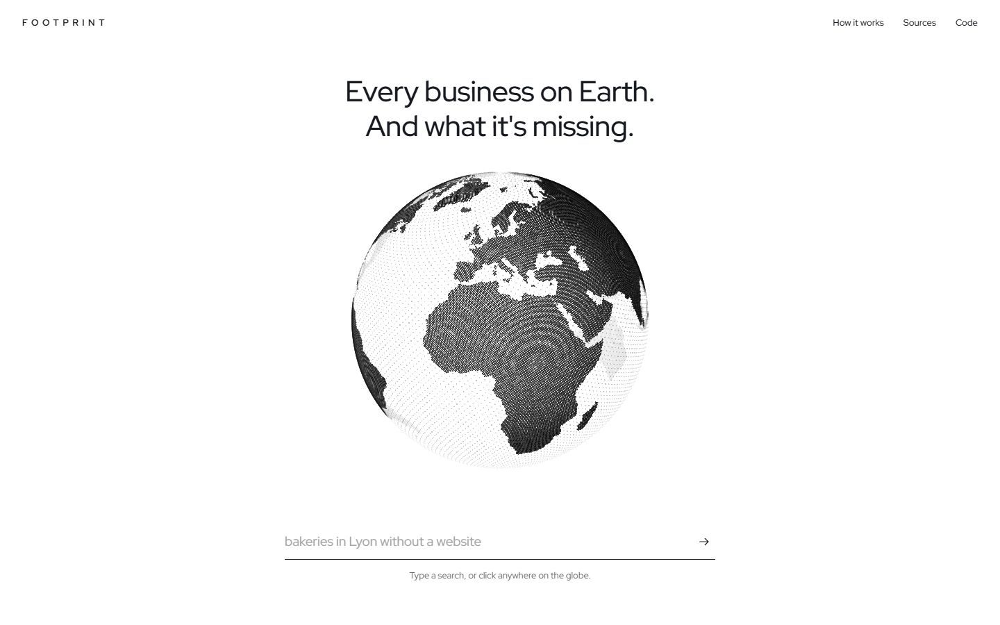
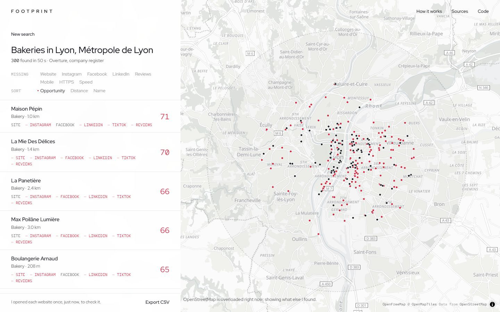
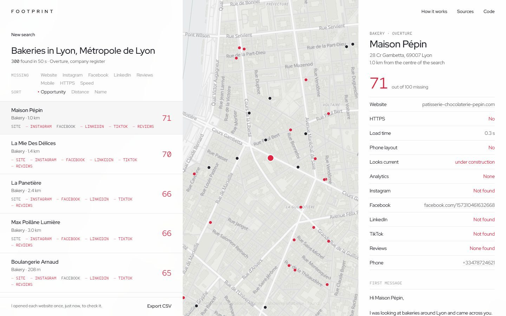
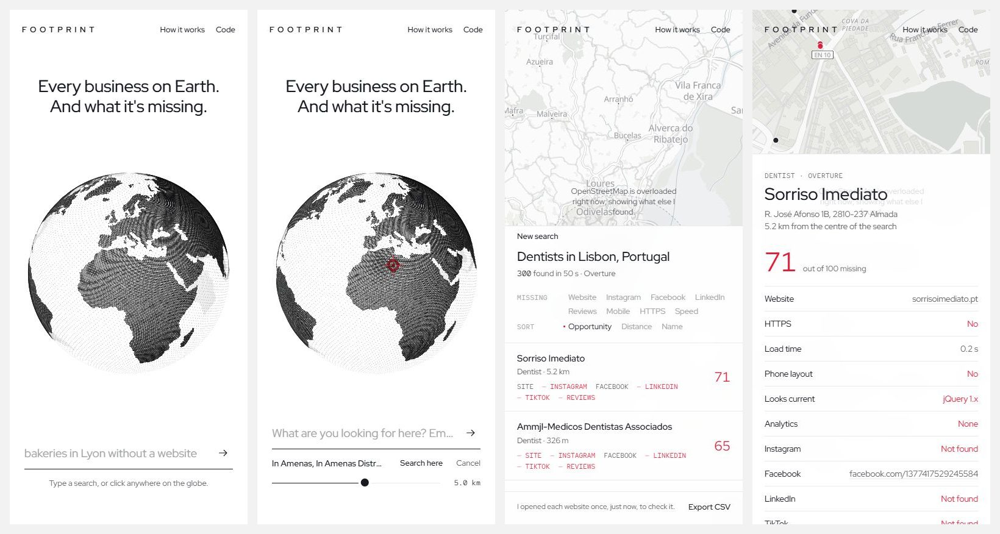

# Footprint

Find businesses anywhere in the world, from a one-person plumber to a chain,
and see what their online presence is missing: a website, https, a phone
layout, Instagram, Facebook, LinkedIn, TikTok, reviews, analytics.

**Live:** https://toni-bobocel.github.io/footprint/ (browser-only mode, see below)



Type what you're after in plain words ("dentists in Porto", "new cafés in
Lisbon with no Instagram", "plumbers within 10 km of Manchester") or click
anywhere on the globe, pick a radius, and search there. The globe dives into
a map and results stream in as each source answers. The businesses with the
most missing come first.



Each business gets a page of plain checks and a first message that names
one concrete thing, ready to copy. The list exports to CSV.



## Where the data comes from

| Source                                                               | Covers                                                           | How                                                                                          |
| -------------------------------------------------------------------- | ---------------------------------------------------------------- | -------------------------------------------------------------------------------------------- |
| [Overture Maps](https://overturemaps.org) places                     | worldwide, ~60M places with websites, socials, phones            | GeoParquet on public S3, read with DuckDB; only the row groups around the search are fetched |
| [OpenStreetMap](https://www.openstreetmap.org)                       | worldwide, live, volunteer-mapped                                | public Overpass servers, walked in order when one is busy                                    |
| [Recherche d'entreprises](https://recherche-entreprises.api.gouv.fr) | every registered company in France, incl. ones with no shopfront | `near_point`, with headcount bands and creation dates                                        |
| [Nominatim](https://nominatim.org)                                   | place names to coordinates and back                              | one request a second, as its policy asks                                                     |
| Google Places                                                        | ratings and review counts                                        | only if you set your own `GOOGLE_PLACES_KEY`                                                 |

Records are merged by name and distance, so a bakery found on the map and in
the register shows up once, with the map's website and the register's
headcount.

Then the API opens each business's home page once, like a visitor would, and
notes the final scheme and certificate, load time, viewport tag, old
generators and jQuery 1.x, "under construction" copy, stale copyright years,
social profile links (not share buttons), review links and analytics tags.
No model is involved: every flag is a rule in [`scan.py`](api/src/footprint/scan.py),
and the score is a weighted sum you can read in one dictionary.

Why Overture comes first, why there's no LLM, and what the tool deliberately
won't do are in [`docs/adr`](docs/adr).

## Two ways to run it

**With the API** (full checks). Python 3.13 and [uv](https://docs.astral.sh/uv/):

```sh
cd api
uv sync
uv run uvicorn footprint.app:app --reload
```

```sh
pnpm install
pnpm dev          # http://localhost:5173, finds the API on :8000 by itself
```

Or with Docker, built from the repository root:

```sh
docker build -f api/Dockerfile -t footprint-api .
docker run -p 8000:8000 -v footprint:/data footprint-api
```

**Without it.** The page on GitHub Pages has no server behind it. It queries
Nominatim, Overpass and the French register straight from the browser, so it
works, but it can't open other websites (browsers forbid it) or read
Overture. Its footprint covers what the map records, and it says so.
Point it at a running API with `?api=https://your-host` or the
`FOOTPRINT_API` repository variable.

## Configuration

| Variable             | Default                 |                                            |
| -------------------- | ----------------------- | ------------------------------------------ |
| `OVERTURE`           | `1`                     | set `0` to skip Overture                   |
| `OVERTURE_RELEASE`   | latest                  | pin a release such as `2026-11-18.0`       |
| `OVERPASS_URLS`      | two public instances    | comma-separated, tried in order            |
| `OVERPASS_TIMEOUT_S` | `25`                    | per instance                               |
| `SCAN_CONCURRENCY`   | `12`                    | websites opened at once                    |
| `SCAN_TIMEOUT_S`     | `8`                     | per website                                |
| `MAX_RESULTS`        | `300`                   | per search                                 |
| `GOOGLE_PLACES_KEY`  | unset                   | enables ratings and review counts          |
| `FOOTPRINT_CACHE`    | `footprint.db`          | SQLite cache of places, searches and scans |
| `CORS_ORIGINS`       | localhost, GitHub Pages | comma-separated                            |

## Layout

```
api/       FastAPI service: query parser, sources, merge, site scanner, SSE
web/       Vite + TypeScript: three.js globe, MapLibre map, GSAP motion
shared/    categories.json, read by both (OSM tags, Overture taxonomy, NAF codes)
docs/adr/  decisions and their trade-offs
```

The globe is 40k land points sampled from Natural Earth on a Fibonacci
lattice (`web/scripts/land.mjs`) plus a sparse veil over the oceans, drawn by
one shader that fades the far side and swells the surface under the pointer.



## Limits

- Coverage follows the data: dense in European and North American cities,
  thinner elsewhere. Overture lags reality by up to a month.
- The public Overpass servers are often at capacity. When they are, the page
  says so instead of showing an empty map as if nothing were there.
- "No Instagram" means no link was found on the map or the home page, not a
  search of Instagram itself.
- In France, businesses known only to the register show their website as
  unknown rather than missing: the register doesn't record websites.

## Licence

Code under MIT. Data: Overture Maps under CDLA-Permissive-2.0, with
OpenStreetMap-derived records under ODbL. OpenStreetMap © contributors, ODbL.
Base map by OpenFreeMap and OpenMapTiles. Land outlines from Natural Earth,
public domain. Recherche d'entreprises under the Licence Ouverte.
